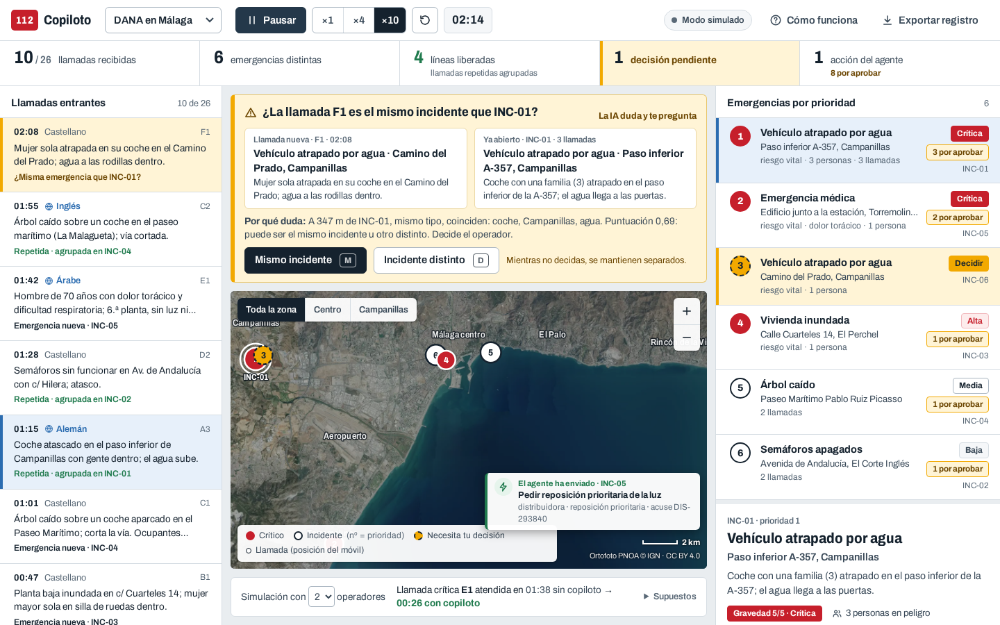

# Agente 112

Agente de IA para las salas del 112 en España. En una catástrofe (DANA, apagón) **agrupa las llamadas que hablan del mismo incidente**, **detecta las que traen información nueva** y **traduce en tiempo real** a quien no habla castellano. La IA propone; **el operador decide**. Los modelos corren **en local**.



## Arrancar en modo simulado (2 comandos, sin GPU, sin wifi, sin claves)

```bash
npm install
npm run dev        # http://localhost:3000
```

Pulsa **Iniciar** (velocidad ×4 o ×10). Verás 26 llamadas en 6 idiomas convertirse en 7 incidentes. Dos veces la consola se para en **ámbar** y pregunta: `M` = mismo incidente, `D` = incidente distinto. En el modo simulado la agrupación y la prioridad **se calculan igual** con el algoritmo real; solo la extracción de cada llamada viene del guion. La demo no hace ninguna petición externa: el mapa es una ortofoto del IGN incluida en la aplicación (sin teselas) y la fuente se instala con npm. El botón **Cómo funciona** lo explica todo en un minuto; el mapa se arrastra y se acerca con la rueda o con + y −.

El selector de la barra superior cambia entre dos escenarios: **DANA en Málaga** (26 llamadas, 6 idiomas) y **Apagón en Málaga** (16 llamadas: ascensores, semáforos, oxígeno domiciliario y una residencia sin luz), para ver que el sistema generaliza.

## Qué enseña la demo

1. **Agrupar**: 26 llamadas → 7 incidentes. El contador de «líneas liberadas» sube.
2. **Información nueva**: una llamada duplicada no se descarta; si dice «hay un bebé» o «no contesta», se avisa y sube la prioridad.
3. **La ubicación del llamante no es la del incidente**: quien llama desde otro barrio se agrupa por la dirección que menciona.
4. **Zona gris visible**: un segundo coche atrapado a ~460 m del primero no se fusiona solo; decide el operador.
5. **Simulación de sala**: espera hasta atender la llamada crítica con y sin copiloto (con 1–4 operadores). Son supuestos ilustrativos (60 s por llamada nueva, 15 s por duplicado), no datos reales.
6. **Respuesta traducida**: frases rápidas (o texto libre con IA local) en el idioma del llamante, con voz.

## Presentación interactiva (`/presentacion`)

Se abre con **Ver la presentación** en la bienvenida de la consola, con el icono de la barra superior o directamente en `http://localhost:3000/presentacion`. Son 12 diapositivas en HTML dentro de la propia web. Empiezan por el problema: la DANA de Valencia, el apagón y seis llamadas por el mismo coche. Siguen con piezas **reales** de la consola funcionando: la consola completa en directo, la decisión de la zona gris, las acciones del agente y la respuesta en árabe. Todas responden al ratón y a las teclas `M` y `D`. Al final hay un QR a la página principal, y al pasar de esa diapositiva se abre la consola.

- Teclas: `←` `→` o espacio para avanzar, `F` pantalla completa, `N` notas del orador (el guion de `docs/PITCH.md`). La dirección guarda la diapositiva (`/presentacion#6`).
- Si llegas a la consola desde la presentación (pasando de la última diapositiva, con el logo o con la ×), aparece abajo a la derecha **Volver a la presentación**, que te devuelve a la diapositiva de la que saliste.
- El QR apunta a la web desde la que se abre la presentación (en GitHub Pages, la página publicada). Si presentas desde `localhost`, fija la dirección pública con `NEXT_PUBLIC_DEMO_URL=https://… npm run dev`.
- Funciona sin red: el QR se genera en el navegador (`lib/qr.ts`) y la consola de las diapositivas calcula siempre en modo simulado (`lib/replay.ts` y `useConsole({ offline: true })`).

## Activar la IA local (GPU NVIDIA)

```bash
bash scripts/setup-modelos.sh      # levanta Ollama + speaches con Docker y descarga modelos según tu VRAM
npm run dev                        # la barra superior pasa a «IA local: <modelo>»
```

Sin Docker ni sudo (si Docker no ve la GPU): `bash scripts/ia-local.sh` arranca Ollama (`~/.local/ollama`) y un servidor de Whisper propio (`scripts/stt_server.py`), y crea `.env.local`. Para pararlos: `bash scripts/ia-local.sh stop`. Con IA real, reproduce el escenario a ×1.

**Versión web (modo simulado):** cada push a `main` publica la consola en GitHub Pages (`.github/workflows/pages.yml`). Requisito: *Settings → Pages → Source: GitHub Actions*.

| VRAM | LLM | Voz a texto |
|---|---|---|
| 8 GB | `qwen2.5:7b-instruct` | `faster-whisper-small` |
| 12–16 GB | `qwen2.5:14b-instruct` | `faster-whisper-large-v3-turbo` |
| 24 GB o más | `qwen2.5:32b-instruct` | `faster-whisper-large-v3` |

Todo se configura con `.env.local` (plantilla en `.env.example`): `LLM_BASE_URL`, `LLM_MODEL`, `STT_BASE_URL`, `STT_MODEL`. Con IA local, además: texto libre traducido, opinión del modelo en la zona gris (solo opina, nunca decide) y **llamada en directo** con el micrófono.

Audio de las llamadas simuladas: los MP3 ya vienen en `public/audio/` (1,3 MB) y la consola los reproduce sin red (botón **Sonido** en la barra superior; a ×10 no suenan solas, pero cada llamada tiene **Escuchar**). Para regenerarlos: `python3 -m venv .venv-audio && .venv-audio/bin/pip install edge-tts && .venv-audio/bin/python scripts/generate_audio.py` (o Piper). Crea `<id>.wav` (para Whisper, ignorado por git) y `<id>.mp3`, con filtro de teléfono y lluvia en la DANA.

## Arquitectura

```
navegador (consola) ── POST /api/process ──▶ servidor Next.js (sin estado)
  reloj + cola SERIE                           ├─ STT (Whisper) o guion
  estado de incidentes                         ├─ extracción JSON (LLM) o mock
  decisiones del operador                      ├─ agrupación determinista (lib/cluster.ts)
                                               └─ zona gris: el LLM opina, decide el operador
```

- `lib/cluster.ts`: puntuación 0,45·espacio + 0,30·tipo + 0,25·texto; ≥ 0,78 fusiona, 0,45–0,78 pregunta, < 0,45 incidente nuevo. Cada decisión lleva su motivo en castellano.
- `lib/engine.ts`: estado de incidentes (fusionar, provisional, confirmar, **Separar**), puro y probado.
- `lib/priority.ts`: gravedad, personas, riesgo vital, información nueva y tiempo sin atender.
- Sin base de datos: el estado vive en el cliente. Sin teselas ni fuentes externas.
- Mapa: ortofoto PNOA © Instituto Geográfico Nacional (CC BY 4.0) en `assets/map/`, generada una sola vez con `python3 scripts/build_satellite.py` (descarga del WMS del IGN y rellena los huecos del mosaico sobre el mar). Misma proyección que `lib/map.ts`.

## Comprobaciones

```bash
npm run build && npm test && npm run eval     # compilación, 27 tests, evaluación sobre el escenario
npm run eval:apagon                           # evaluación del escenario del apagón (6 incidentes, 1 pregunta)
npm run eval -- --live                        # lo mismo con el LLM local (se salta si no hay LLM_BASE_URL)
npm run start -- -p 3112 & node scripts/e2e.mjs   # prueba extremo a extremo con Playwright
```

`npm run eval` agrupa las 26 llamadas y compara con la referencia: **7 incidentes, 0 fusiones incorrectas, 2 preguntas al operador**, y la llamada en árabe (infarto) entre las dos primeras de la cola.

## Privacidad y Ley de IA

- **Local por diseño**: las llamadas contienen datos de salud y localización; los modelos se ejecutan en la sala, sin nube. El servidor no guarda nada.
- **Humano en el bucle**: clasificar llamadas de emergencia es alto riesgo en la Ley de IA europea (obligaciones desde dic-2027). La zona gris nunca se resuelve sola, cada fusión automática se puede deshacer con «Separar» y cada decisión explica por qué.
- **Registro**: el botón «Exportar registro» descarga en JSON cada decisión (automática o del operador), su puntuación, su motivo y las respuestas enviadas.
- Todos los datos del escenario son ficticios.

## Alcance

MVP de hackathon. Fuera: integración con un CAD real, autenticación, telefonía real, despliegue en la nube. La IA se evalúa por **líneas liberadas** y **tiempo hasta la llamada crítica**, no por precisión del modelo.

Más: [docs/MEMORIA.md](docs/MEMORIA.md) (especificación), [docs/PITCH.md](docs/PITCH.md), [docs/DECISIONES.md](docs/DECISIONES.md).
