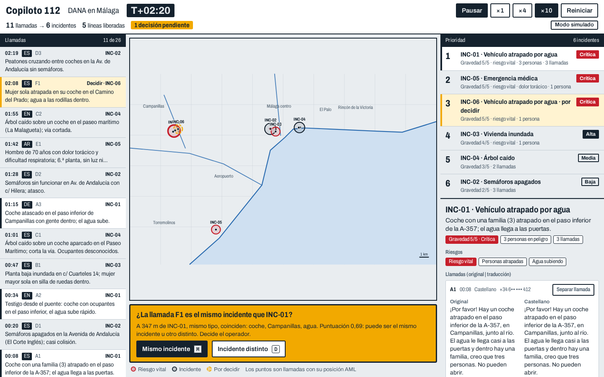

# Copiloto 112

Copiloto de IA para las salas del 112 en España. En una catástrofe (DANA, apagón) **agrupa las llamadas que hablan del mismo incidente**, **detecta las que traen información nueva** y **traduce en tiempo real** a quien no habla castellano. La IA propone; **el operador decide**. Los modelos corren **en local**.



## Arrancar en modo simulado (2 comandos, sin GPU, sin wifi, sin claves)

```bash
npm install
npm run dev        # http://localhost:3000
```

Pulsa **Iniciar** (velocidad ×4 o ×10). Verás 26 llamadas en 6 idiomas convertirse en 7 incidentes. Dos veces la consola se para en **ámbar** y pregunta: `M` = mismo incidente, `D` = incidente distinto. En el modo simulado la agrupación y la prioridad **se calculan igual** con el algoritmo real; solo la extracción de cada llamada viene del guion. La demo no hace ninguna petición externa (mapa SVG propio, fuente instalada con npm).

## Qué enseña la demo

1. **Agrupar**: 26 llamadas → 7 incidentes. El contador de «líneas liberadas» sube.
2. **Información nueva**: una llamada duplicada no se descarta; si dice «hay un bebé» o «no contesta», se avisa y sube la prioridad.
3. **La ubicación del llamante no es la del incidente**: quien llama desde otro barrio se agrupa por la dirección que menciona.
4. **Zona gris visible**: un segundo coche atrapado a ~460 m del primero no se fusiona solo; decide el operador.
5. **Respuesta traducida**: frases rápidas (o texto libre con IA local) en el idioma del llamante, con voz.

## Activar la IA local (GPU NVIDIA)

```bash
bash scripts/setup-modelos.sh      # levanta Ollama + speaches con Docker y descarga modelos según tu VRAM
npm run dev                        # la barra superior pasa a «IA local: <modelo>»
```

| VRAM | LLM | Voz a texto |
|---|---|---|
| 8 GB | `qwen2.5:7b-instruct` | `faster-whisper-small` |
| 12–16 GB | `qwen2.5:14b-instruct` | `faster-whisper-large-v3-turbo` |
| 24 GB o más | `qwen2.5:32b-instruct` | `faster-whisper-large-v3` |

Todo se configura con `.env.local` (plantilla en `.env.example`): `LLM_BASE_URL`, `LLM_MODEL`, `STT_BASE_URL`, `STT_MODEL`. Con IA local, además: texto libre traducido, opinión del modelo en la zona gris (solo opina, nunca decide) y **llamada en directo** con el micrófono.

Audio de las llamadas simuladas (opcional): `pip install edge-tts` y `python3 scripts/generate_audio.py` (o Piper) crea `public/audio/<id>.wav` con filtro de teléfono y lluvia.

## Arquitectura

```
navegador (consola) ── POST /api/process ──▶ servidor Next.js (sin estado)
  reloj + cola SERIE                           ├─ STT (Whisper) o guion
  estado de incidentes                         ├─ extracción JSON (LLM) o mock
  decisiones del operador                      ├─ agrupación determinista (lib/cluster.ts)
                                               └─ zona gris: el LLM opina, decide el operador
```

- `lib/cluster.ts`: puntuación 0,45·espacio + 0,30·tipo + 0,25·texto; ≥ 0,78 fusiona, 0,45–0,78 pregunta, < 0,45 incidente nuevo. Cada decisión lleva su motivo en castellano.
- `lib/engine.ts`: estado de incidentes (fusionar, provisional, confirmar, **Separar**), puro y probado.
- `lib/priority.ts`: gravedad, personas, riesgo vital, información nueva y tiempo sin atender.
- Sin base de datos: el estado vive en el cliente. Sin teselas ni fuentes externas.

## Comprobaciones

```bash
npm run build && npm test && npm run eval     # compilación, 27 tests, evaluación sobre el escenario
npm run eval -- --live                        # lo mismo con el LLM local (se salta si no hay LLM_BASE_URL)
npm run start -- -p 3112 & node scripts/e2e.mjs   # prueba extremo a extremo con Playwright
```

`npm run eval` agrupa las 26 llamadas y compara con la referencia: **7 incidentes, 0 fusiones incorrectas, 2 preguntas al operador**, y la llamada en árabe (infarto) entre las dos primeras de la cola.

## Privacidad y Ley de IA

- **Local por diseño**: las llamadas contienen datos de salud y localización; los modelos se ejecutan en la sala, sin nube. El servidor no guarda nada.
- **Humano en el bucle**: clasificar llamadas de emergencia es alto riesgo en la Ley de IA europea (obligaciones desde dic-2027). La zona gris nunca se resuelve sola, cada fusión automática se puede deshacer con «Separar» y cada decisión explica por qué.
- **Registro**: la consola guarda un registro de decisiones en memoria (auditoría); su exportación está en el tablero de mejoras.
- Todos los datos del escenario son ficticios.

## Alcance

MVP de hackathon. Fuera: integración con un CAD real, autenticación, telefonía real, despliegue en la nube. La IA se evalúa por **líneas liberadas** y **tiempo hasta la llamada crítica**, no por precisión del modelo.

Más: [docs/MEMORIA.md](docs/MEMORIA.md) (especificación), [docs/PITCH.md](docs/PITCH.md), [docs/DECISIONES.md](docs/DECISIONES.md).
