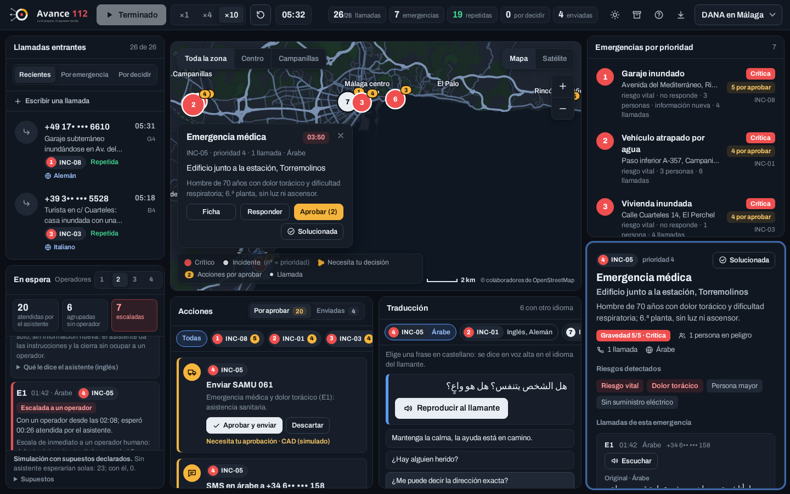
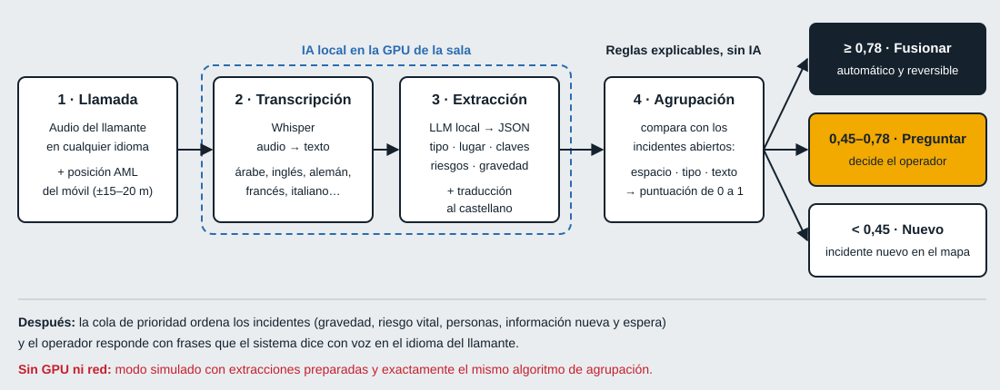
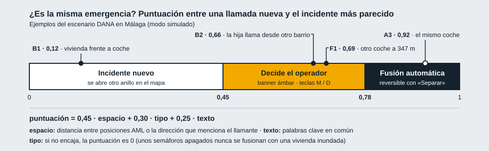
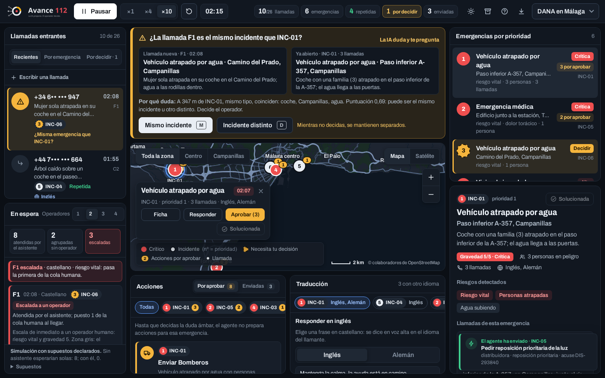
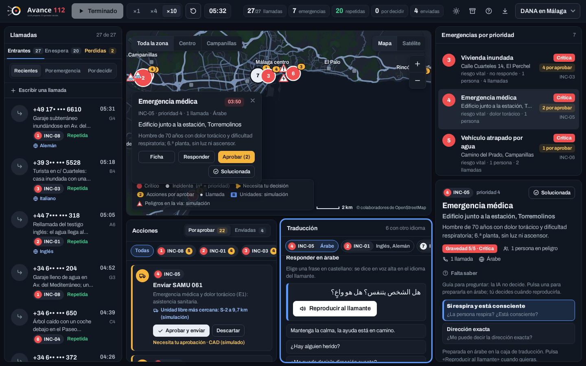
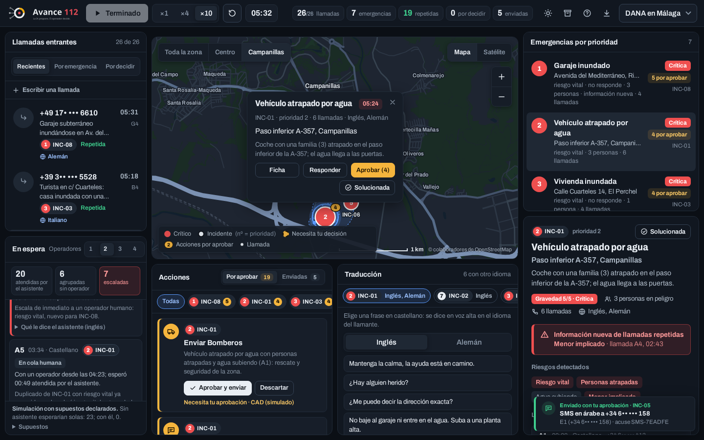
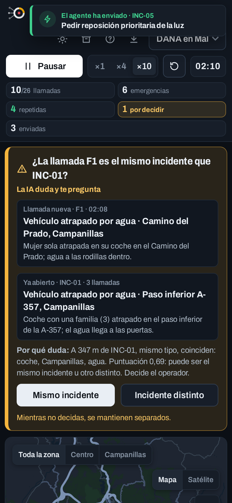
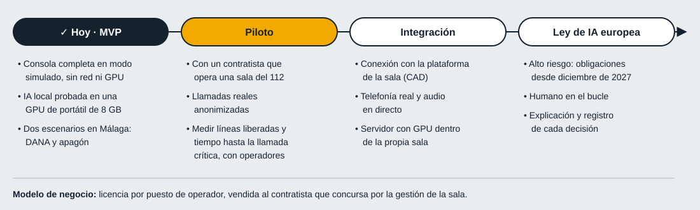

# Agente 112: explicación e ideas

> Borrador de trabajo para completar y comparar ideas. Cifras: solo las de `docs/MEMORIA.md` §3, con su fuente.

## Qué es

Agente de IA para las salas del 112 en catástrofes (DANA, apagón). Hace tres cosas:
- **agrupa** las llamadas que hablan de la misma emergencia;
- **detecta** cuándo un duplicado trae información nueva;
- **traduce** la respuesta del operador al idioma del llamante.

La IA propone y el operador decide. Todo funciona en local.

## El problema

- DANA de Valencia (2024): 19.821 llamadas para 4.770 incidentes, unas 4 por incidente *(112 C. Valenciana)*.
- Apagón (2025): llamadas ×4; más de 10.000 perdidas en Cataluña *(112 autonómicos)*.
- 43.845 llamadas en idioma extranjero en el 112 Andalucía en 2024 *(Junta de Andalucía)*. Hoy se traducen con intérprete humano, que tarda unos 30 s en conectar *(112 Catalunya)*.

→ En una catástrofe el cuello de botella son **las líneas**, no los recursos.

## Cómo funciona

## Cómo se ve

| Zona gris: la IA pregunta | Respuesta en árabe |
|---|---|
|  |  |

| Detalle en Campanillas (ortofoto IGN) | Móvil |
|---|---|
|  |  |

La captura con IA real en GPU (24-nov-2026, interfaz anterior) está en `capturas/gpu-ia-local-decision.png`.

## Estado

- MVP `mvp-v1`: dos escenarios (DANA y apagón), 33 tests. El eval simulado está en verde: 0 fusiones incorrectas.
- IA real probada en la RTX 4070 (8 GB):
  - Whisper: 0,4–0,9 s por llamada y muy preciso, también en árabe.
  - qwen2.5:7b: 0 fusiones incorrectas, pero pregunta de más, varía entre ejecuciones, tarda 4–9 s por llamada y más cuando la GPU se calienta.

## A futuro: qué pretende solucionar

- Que los duplicados no colapsen las líneas en la próxima catástrofe.
- Que la llamada crítica (información nueva, idioma extranjero) salga la primera.
- Que nadie espere a un intérprete para ser atendido.
- IA de emergencias conforme a la Ley de IA por diseño: humano en el bucle, explicación y registro.

## Ideas para comparar

Lista completa (52 ideas, con las elegidas para la Fase 7): [`IDEAS.md`](IDEAS.md).

| Idea | Qué aporta | Esfuerzo | ¿La hacemos? |
|---|---|---|---|
| Modelo más grande o ajustado para la extracción | Menos preguntas de más y menos riesgos inventados | Medio: VRAM y disco | ? |
| Seguir afinando el prompt del 7B | Barato, pero varía entre ejecuciones | Bajo | ? |
| Modo mixto en la demo: escenario simulado + IA real en micrófono y traducción | Demo fiable y además «real» | Bajo | ? |
| Servidor con GPU en la sala, no en un portátil | Latencia estable, sin bajadas por calor | Alto | ? |
| Integración con la plataforma de la sala (CAD) | Necesario para un piloto | Alto | ? |
| Nuevos escenarios: … | … | … | ? |
| … | … | … | ? |

## Preguntas abiertas

- [ ] ¿Con qué contratista podemos hacer el piloto?
- [ ] ¿Cómo conseguir llamadas reales anonimizadas para evaluar?
- [ ] ¿Qué métrica enseñamos al jurado: líneas liberadas o tiempo hasta la llamada crítica?
- [ ] …
