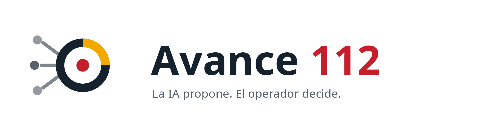

# Avance 112 · Logo animado

Abre [index.html](index.html) en un navegador para ver la entrada, repetirla,
pausarla, activar las señales y cambiar entre fondo claro, oscuro y transparente.
La página funciona directamente como archivo local, sin servidor ni conexión.

Se conserva el símbolo de [../simbolo.svg](../simbolo.svg), sus proporciones
y los significados definidos en [Marketing](../../MARKETING.md). El nombre
«Avance 112» corresponde a la petición para esta entrega. La tipografía es
Archivo, peso 700 para el nombre y 400 para el eslogan, convertida a trazados.
Los archivos no necesitan cargar fuentes externas.

| Archivo | Uso |
|---|---|
| [avance-112-animado.svg](avance-112-animado.svg) | Entrada e interacción sobre fondos claros |
| [avance-112-animado-oscuro.svg](avance-112-animado-oscuro.svg) | Entrada e interacción sobre fondos oscuros |
| [avance-112.svg](avance-112.svg) / [oscuro](avance-112-oscuro.svg) | Vector estático, sin dependencias de animación |
| [avance-112-simbolo.svg](avance-112-simbolo.svg) | Símbolo aislado para espacios pequeños |
| [avance-112.png](avance-112.png) / [oscuro](avance-112-oscuro.png) | PNG estático transparente, 2200 × 600 |
| [avance-112.webp](avance-112.webp) | Entrada animada, transparencia con bordes suaves |
| [avance-112.apng](avance-112.apng) | Entrada animada PNG con alfa completo |
| [avance-112.gif](avance-112.gif) | Entrada animada con transparencia binaria |
| [vista-previa.png](vista-previa.png) | Captura de la página de demostración |

El SVG tiene un lienzo de 1100 × 300 y fondo transparente. La entrada dura
1,9 s y termina en reposo. Al pasar el cursor o enfocar con el teclado, las
señales recorren las conexiones y el centro se enfatiza suavemente. No hay
destellos ni sonidos. Con `prefers-reduced-motion: reduce`, se muestra el
estado final sin movimiento.

WebP, GIF y APNG capturan la entrada y una pausa hasta completar un bucle de
4,8 s a 25 fps; no incorporan interacción ni detectan preferencias del sistema.
Son las versiones para fondos claros. En un fondo oscuro, usa el SVG/PNG oscuro.
El GIF pierde la transparencia parcial de los bordes; WebP y APNG la conservan.

Para conservar legible el eslogan, se recomienda un ancho de al menos 440 px.
En espacios menores, usa el símbolo aislado (mínimo 24 px de alto).

## Integración

```html
<!-- La entrada CSS funciona también como imagen. -->


<!-- Para interacción con cursor y teclado: SVG inline u object. -->
<object type="image/svg+xml" data="avance-112-animado.svg"
        width="550" height="150" aria-label="Avance 112">
  
</object>
```

En un ``, la animación se ejecuta al cargar el recurso; la interacción
interna requiere SVG inline, `<object>` o abrir el SVG directamente. La vista
previa usa SVG inline y JavaScript únicamente para sus controles. Si se insertan
varias copias inline en una página, hay que dar identificadores únicos a sus
`title`/`desc` y actualizar `aria-labelledby`.

## Regeneración

Desde la raíz del repositorio, con las dependencias del proyecto instaladas:

```bash
python3 docs/marca/avance-112/build.py
node docs/marca/avance-112/export-frames.mjs /tmp/avance-112-frames
python3 docs/marca/avance-112/encode-animation.py /tmp/avance-112-frames
```

`build.py` requiere PyCairo, PyGObject, Pango, librsvg y Fontconfig del sistema.
Lee Archivo de `node_modules/@fontsource-variable/archivo` (licencia OFL-1.1).
El exportador usa Playwright y su Chromium instalado. El codificador usa Pillow.
`preview.template.html` es la fuente de la página; `build.py` inserta el SVG en
`index.html`. Los fotogramas intermedios quedan fuera del repositorio.

Verificado con Chromium: entrada, SVG independiente, cursor, foco de teclado,
pausa, repetición, cambio de fondo, escritorio, móvil de 390 px, movimiento
reducido y ausencia de errores JavaScript. Los archivos animados se decodifican
completos con Pillow y se comprueban duración y esquinas transparentes; el
informe está en [animation-export.json](animation-export.json).
